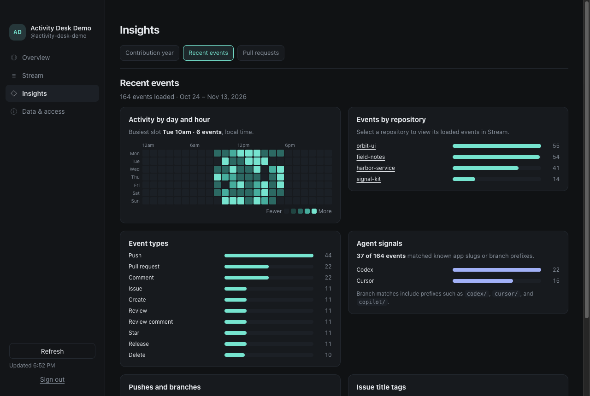

# Activity Desk

Activity Desk is a macOS dashboard for GitHub activity. Review your recent events, see which pull requests are still open, and compare contribution trends from one window.

## What you can see

- **Overview** shows recent contribution totals, open PRs in the loaded sample, and unread notifications when the token supports them.
- **Stream** filters loaded events by type, repository, and search text. **Mark all seen** updates an account-specific timestamp on this Mac.
- **Insights** compares two 30-day periods and charts monthly contributions, streaks, and repository totals. **Recent events** shows activity by local day and hour. Select a repository there to open its events in Stream. **Pull requests** shows merge timing, recorded reviews, and change sizes for the loaded sample.
- **Data & access** reports which sources loaded, where the data is limited, and which token type is in use.

## Screenshots

The running app shows a fictional account and synthetic GitHub data.

### Contribution year


### Recent events



## Run a local copy

This repository contains the app source and bundle metadata. You need an existing compatible arm64 Activity Desk bundle with Electron 45 or later. The bundled Electron runtime and stock assets are kept outside Git.

1. Make a development copy of `Activity Desk.app`.
2. Copy the files from `Activity Desk.app/Contents/Resources/app/` in this checkout into the development bundle's `Contents/Resources/app/`.
3. Open the development copy and sign in with a GitHub personal access token.

The workspace launcher has an incomplete bundle signature. A distributable download needs separately built and signed packaging.

## Automated macOS releases

The release workflow runs after a pull request is merged into `main`. It waits for Verify, both CodeQL analyses, and the other checks reported on that commit to succeed before creating a GitHub release. GitHub's skipped CodeQL configuration adjustment is allowed. The workflow waits for 50 seconds of successful checks to allow additional checks to register. Checks that register later cannot hold back an already published release. A release contains an Apple silicon app ZIP and a SHA-256 checksum. The app is ad-hoc signed and is not notarized, so macOS Gatekeeper can require a manual exception. Each release tag contains the merge commit SHA.

The workflow downloads the pinned Electron arm64 archive and checks its SHA-256 before assembling the app. To build the same archive on a Mac, run `bash scripts/package-macos.sh /path/to/output`.

## GitHub access

Start with a fine-grained token. Use **Events** read access to see private events. Grant **Pull requests** read access to the repositories whose private PR details you want to see. GitHub's unread notifications endpoint requires a classic token with the `notifications` scope. A classic `repo` scope grants write access to other clients holding the token. [GitHub token documentation](https://docs.github.com/en/authentication/keeping-your-account-and-data-secure/managing-your-personal-access-tokens)

| Source | Coverage |
| --- | --- |
| Recent events | Up to 300 GitHub events from the past 30 days. GitHub can delay or omit events. [Events API](https://docs.github.com/en/rest/activity/events) |
| Pull requests | Details for up to 40 distinct PRs mentioned in the loaded events. Review counts reflect the records visible at refresh time. |
| Contribution year | GitHub's rolling contribution calendar. Commit breakdowns use up to 10 returned repositories. The 30-day comparison includes the current day. [Contributions collection](https://docs.github.com/en/graphql/reference/users#contributionscollection) |
| Notifications | The first page of up to 50 unread notifications. [Notifications API](https://docs.github.com/en/rest/activity/notifications) |

Agent signals come from known app slugs and branch prefixes. Push counts classify the refs GitHub reports.

## Local data and privacy

- The main process sends the token to `api.github.com` for allowlisted reads. The dashboard displays initials generated locally.
- macOS Keychain backs encryption of the token in the local Electron profile. The app encrypts a legacy plaintext token on first use. Signing out clears the dashboard and removes the saved token. The account-specific seen timestamp stays in the local profile.
- A signed-in dashboard can show private repository names and activity. Use an isolated profile and synthetic responses for reusable screenshots and test evidence.

See [SECURITY.md](SECURITY.md) for private vulnerability reporting.

## Development checks

```sh
for file in 'Activity Desk.app/Contents/Resources/app/'*.js; do
  node --check "$file" || exit
done
node --test tests/insights.test.cjs
node --test tests/main.test.cjs
```

For a native fixture run, use a separate bundle identity and set Electron's `userData` and `sessionData` to scratch directories before loading `main.js`. Use synthetic credentials and GitHub responses. The renderer needs the preload bridge for authenticated views.
