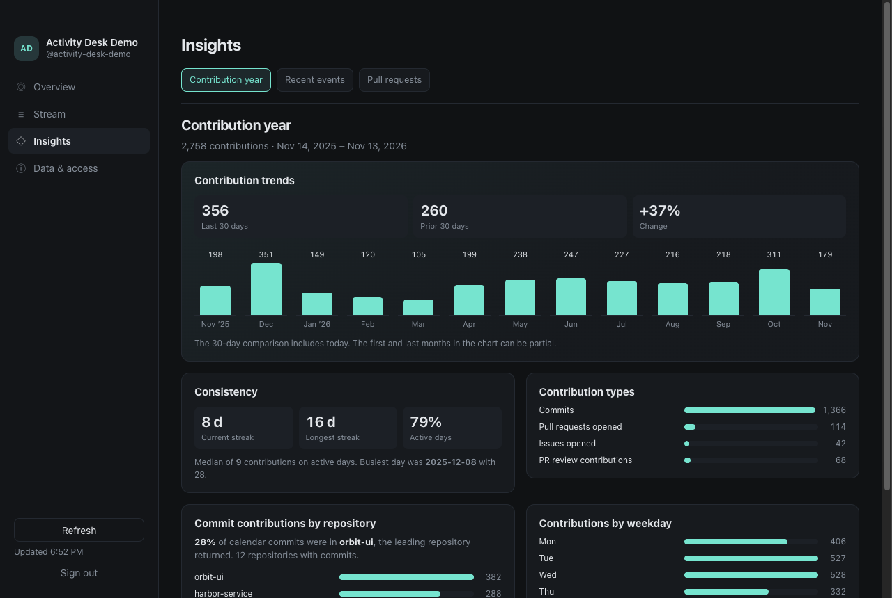

# Activity Desk

Activity Desk is a read-only GitHub dashboard for Apple silicon Macs. Use it to catch up on recent activity across your repositories, spot open pull requests and review requests in the loaded data, and compare contribution trends over time.

- **Stream** shows your recent events and, under **Conversations**, the latest comments and reviews from anyone on issues and pull requests that involve you, open or closed. Each refresh reads those threads directly, so new replies appear without waiting for GitHub's activity feed.
- **Insights → Patterns** goes beyond raw counts. It shows how concentrated your output is, whether weekly output shifted, how often branches reach a merge, and how long your pull requests wait for a human review. Each finding names its source and needs a minimum sample before it appears. Pull request findings cover every pull request you opened in the last 90 days, found by search, not only those that appear in the Events feed.
- **Insights → Footprint** shows who finds your repositories: page views, unique visitors, clones, referring sites, and new stars. GitHub keeps only 14 days of traffic, so Activity Desk saves daily history on your Mac, encrypted, to show trends over months. You can turn it off.
- **Data & access** checks the token itself: when it expires, whether a classic token's scopes allow writes, which permission GitHub says a denied request needs, and how much of the REST and GraphQL rate limits remain.

- [Quick start](docs/quick-start.md) for installation and GitHub token setup
- [User guide](docs/user-guide.md) for the dashboard, data limits, and privacy
- [Documentation](docs/) for setup, usage, and release maintenance

Activity Desk reads GitHub data using a token you provide. A read-only fine-grained token is recommended. macOS Keychain backs encryption of the saved token. See the [security policy](SECURITY.md) for private vulnerability reporting.
