# User guide

Activity Desk gives you one place to review GitHub activity across the repositories visible to your token, or to the two tokens you save for one account. See [Quick start](quick-start.md) to install the app and sign in.

## Views

- **Overview** starts with **Waiting on you**: review requests, replies you have not answered, and your pull requests with changes requested. Below it are four numbers, **Needs a look** for outcome and access warnings, unread notifications when available, and the contribution year. See [Reading Overview](#reading-overview).
- **Stream** has three sources. **Your events** filters your loaded events by type, repository, and search text. Clear **Hide routine changes** to include events such as PR label changes. Comment, review, and agent rows show what was written. See [Reading comment text](#reading-comment-text). Several pushes to one branch within an hour appear as one row, with the number of pushes and commits and the time span. The day heading still counts each event. Select a row's repository, or its issue or pull request number, to open it on github.com. **Conversations** lists comments, reviews, and review comments on issues and pull requests that involve you, open or closed, including replies from other people. **Awaiting reply** shows open threads you opened or wrote in where the latest comment from a person is someone else's. **Mark all seen** updates a timestamp for your account on this Mac, and both sources mark newer items as **New**. **Notes** holds sticky notes you write. See [Using Notes](#using-notes).
- **Insights** shows your contribution calendar, an event heatmap, and merge timing, recorded reviews, and change sizes for loaded pull requests. In **Recent events**, select a repository to open its events in Stream. **Patterns** derives findings the other views do not state: how concentrated your output is, where the last four weeks rank in the year, how events group into work sessions, how agent-branch merges compare with the rest, whether weekly output shifted, how often branches reach a merge, how long your pull requests wait for a person to review them, and who you review with in each direction. **Footprint** shows traffic to the repositories you own. See [Reading Footprint](#reading-footprint). **All years** compares calendar years. See [Reading All years](#reading-all-years).
- **Suggestions** turns patterns in the loaded data into specific changes to try, each with its evidence and sources. See [Reading Suggestions](#reading-suggestions).
- **Data & access** shows which sources loaded and flags limits, missing data, and permission errors. **What to change** lists fixes for the gaps, **What each source covers** shows how far back each source looks, and **Token check** and **Rate-limit budget** describe each saved token and what the refresh sent. See [Reading Data & access](#reading-data--access), [Checking your tokens](#checking-your-tokens), and [Using two tokens](#using-two-tokens).

### Reading Overview

**Waiting on you** has three lists. Each is sorted oldest first, and each names a pull request or issue you can select to open on github.com. An age shown in amber has waited a day or more, the one-business-day mark from Google's review guide.

- **Review requests** come from one extra request: GitHub's search for open pull requests whose `review-requested` matches you, by name or through a team. GitHub drops a pull request from that search once you review it. Each request is timed from the latest time someone asked for your review, read from the pull request's timeline, so a request repeated after you reviewed starts the clock again. A request made through a team uses the team's latest request. When no request time can be read, the request is timed from when the pull request opened, and the row says so. Up to 50 requests load, oldest first.
- **Replies to answer** come from Conversations and add no requests. Each is an open thread you opened or wrote in where the latest comment from a person, not a bot, is someone else's. Only the latest 10 comments and reviews on a thread are read, so a reply of yours older than those does not count as writing in the thread.
- **Changes requested on your pull requests** lists your open pull requests whose latest approval or change request from another person asked for changes. Only the first 10 reviews on a pull request are read. A pull request with more reviews than that is left out, and the card says so, because its latest verdict is unknown.

The numbers are the contribution year with your current streak, how many items wait on you, your median time to merge with the point where the slowest quarter begins, and agent signals. **Needs a look** shows the warnings from Patterns, which cover outcomes in your own pull requests such as fixes after merges and pull requests open past your usual merge time, plus token warnings. Other open pull requests, and merges with no recorded review, appear as grey notes, the same rule Patterns and Suggestions use.

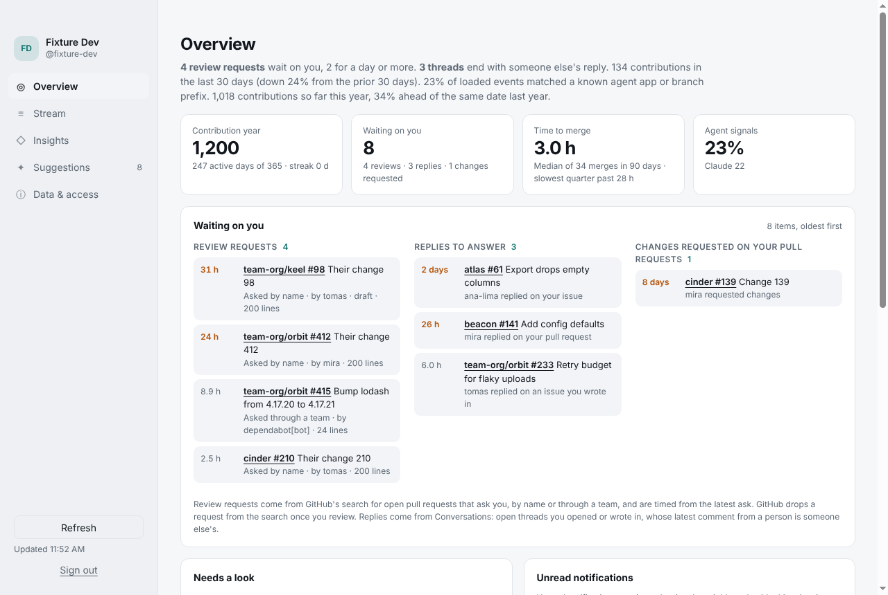

### Reading Patterns

Patterns recombines the loaded sources, and each card and finding names the source it came from. **What stands out** marks a finding as a warning only when it describes an outcome, such as merges followed by fixes or pull requests left open past your usual time. A finding about how work was reviewed is a note unless your own merges show the unreviewed ones needing fixes more often, beyond chance. A finding that a suggestion acts on carries a link to that suggestion. The five strongest findings show first: warnings, then findings that passed a chance check (tagged **Beyond chance**), then the rest. **Show all** opens the others, and a link from a suggestion opens the list when its finding is among them. Only **Review partners** adds a request of its own: a search for pull requests by other people that you reviewed. The pull request details include when each pull request merged or closed, and the author, time, and verdict (approved, changes requested, or commented) of the first 10 reviews on each one.

- **Output rhythm** uses the contribution year. It shows how few days hold half of your contributions, the typical run of consecutive active days, the longest break, and the rank of the last 28 days among earlier rolling 28-day windows.
- **Work sessions** and **Work mix** use recent events. A session is a run of events with gaps under an hour, in local time. A session crosses repositories when its events touch more than one.
- **Merge patterns** uses the loaded pull requests. It compares agent-branch merges with other merges, and the larger half with the smaller half once six merges are loaded. Each group shows its median time to merge and, from four merges, where its slowest quarter begins. With eight timed merges it also ranks every merge by size and by time to merge and reports the rank correlation (Spearman's ρ). The note under the table says whether each comparison is beyond chance. A chance check deals the same merges out at random 999 times and counts how often the shuffle matches the real gap. Every chance check on the page shares one bar, described under the cards. Agent-branch timing is compared by rank, a Mann-Whitney comparison, because medians of three can match on almost any shuffle. With three merges in each group, no gap can pass, so findings from small groups say they may be chance.
- **Trajectory** uses the contribution year. It finds the week that best splits weekly totals into a before and an after level, with at least six weeks on each side. The split counts as a shift only when it beats the same weeks shuffled into random order 999 times, clearly enough to pass the page's shared bar, and moves the weekly average by at least a quarter, because the best of many possible splits can look meaningful in pure noise. It also compares the chance of an active day after an active day with the chance after an idle day.
- **Follow-through** uses recent events with the loaded pull requests. It counts branches created in the feed that are at least two days old and have no pull request from that branch, and the current outcome of pull requests you opened in the feed.
- **After the merge** uses the pull requests you opened and asks what happened next. A merge counts as followed when another loaded pull request in the same repository, with a title that starts with fix, hotfix, revert, or roll back, opened within three days of it. A follow-up that names a merge by number or quoted title counts against that merge. Any other counts against the nearest merge before it, and only that one. Merges younger than three days are left out, because their follow-up may not exist yet. The table compares how often a fix followed across five splits: agent branches against other branches, the larger half by lines against the smaller, merges with no recorded review against reviewed ones, merges faster than your median against slower ones, and merges between midnight and 4am against other hours. A split is compared once each side has four merges and at least two merges were followed. Each comparison is one of the chance checks that share the page's bar. A title is a proxy. A fix that opens after a merge is not always a fix for it, and fixes opened by people whose pull requests did not load are missed.
- **Open work** uses the pull requests you opened. Each counts as open from creation until it merged, closed, or now. The card shows how many are open now, how many of your others are typically open when you start one, and the most you had open at once. With eight merges it ranks each merge by how many others were open when it opened and by its time to merge, and reports the rank correlation with a chance check. Busy stretches can cause both, so the card describes a pattern, not a cause. Once six merges are loaded, your own merge times set the baseline: an open pull request is past your usual time when it is older than 90% of your merges took, and at least a day old. This replaces the fixed two-week line in findings. The card also says how many finished pull requests that outlasted the slowest quarter of your merges went on to merge, against those that finished sooner. Pull requests opened before the 90-day window are not loaded, so the earliest counts run low. A closed pull request saved before close times were read has no known end and is left out.
- **Working and waiting** splits the time to merge of each merged pull request you opened at its last commit: opening to the last commit is work still landing, and the last commit to the merge is finished work waiting. A last commit made before the pull request opened counts as no work time. The card shows the median of each part, the share of all open hours that came after the last commit, and the three pull requests that waited longest. With eight merges it checks whether the waiting part grows with how many of your other pull requests were open, which is what the open-work finding predicts. Last-commit times are a separate read for up to 120 of your newest merges, so a token that cannot read commits loses only this card, and the card says how many loaded. A rebase rewrites commit times, and a review can still ask for changes after the last commit.
- **Week by week** needs saved history. After each refresh it saves this week's median time to merge, share of merges followed by a fix, average open at once, share of open hours after the last commit, and number of merges, replacing any saved earlier the same week. The table shows each number when it was first saved, about four weeks ago, and now. Each week covers the 90 days before it, so neighbouring weeks share most of their pull requests and a change shows up gradually. A weekly snapshot updates only after a complete search for your pull requests. A capped or partial refresh preserves any snapshot already saved for that week.
- **Review turnaround** uses the pull requests you opened in the last 90 days, found by search, plus any older ones you authored that appear in recent events. The note under the card says when the search was capped. Following the [CHAOSS time to first response](https://chaoss.community/kb/metric-time-to-first-response/) definition, it measures the time from creation to the first review by a person other than you. Bot reviews are left out. It also counts merges that only bots reviewed, merges you made yourself, and the people who review your work. From review verdicts it counts merges approved by another person before the merge, the median time to a first approval, and pull requests where someone requested changes. A merge with only comment reviews counts as reviewed but not approved. With four timed waits it shows where the slowest quarter begins. A table breaks this down by repository, since rulesets and code owners are set per repository. The wait starts when the pull request was ready for review. That is when it opened, or for a draft, the first time it was marked ready, unless someone reviewed it while it was still a draft. Ready-for-review times come from the first 10 ready and review-request events on each pull request's timeline. The note under the card says how many waits started when a draft was marked ready. Review requests do not move this clock, because asking late is part of what this wait measures.
- **Review partners** shows who reviews your pull requests and whose pull requests you review, over the same 90 days. It combines the pull requests you opened with a second search, for pull requests by other people that you reviewed. Each row shows one person: whether review goes both ways, how many of your pull requests they reviewed, how many of theirs you reviewed, and the median time to a first review in each direction. Each person's first review is timed from when that person was asked, if the request came before their review. Otherwise it is timed from when the pull request was ready for review, or from when it opened. So a request made late, or a long draft, does not make a reviewer look slow. The notes under the table say how many times were measured from a request. Only requests to a person by name count. Requests to a team say nothing about which member was asked. Bots and your own reviews are left out. Two findings can appear. One appears when you give at least three times as many reviews as you receive, or the reverse, with at least eight on the busier side. It needs both searches to load in full, because a missing or capped side would look like an imbalance. The other appears when you and one person each reviewed at least three of the other's pull requests, and the median first-review times in the two directions differ by a day or more. On an account where nobody else reviews, the card says so and shows nothing more. Under the table, the card gives your own median time to a first review on other people's pull requests across everyone.

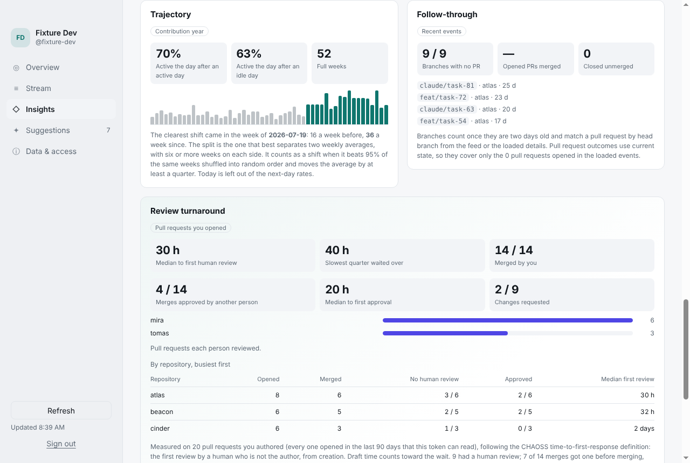

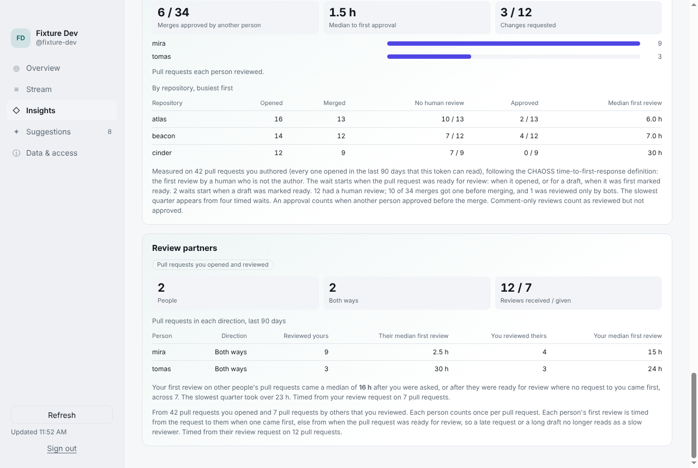

Under **What stands out**, a note says how many chance checks ran on the page and which passed. Running many checks at 5% each would call something "beyond chance" by luck alone: with ten checks and no real effect anywhere, about two times in five. The checks therefore share one bar using Holm's method: the smallest result must beat 5% divided by the number of checks, the next 5% divided by one fewer, and so on, stopping at the first that fails. That keeps the chance of any false "beyond chance" on the page near 5%. It makes small samples pass less often.

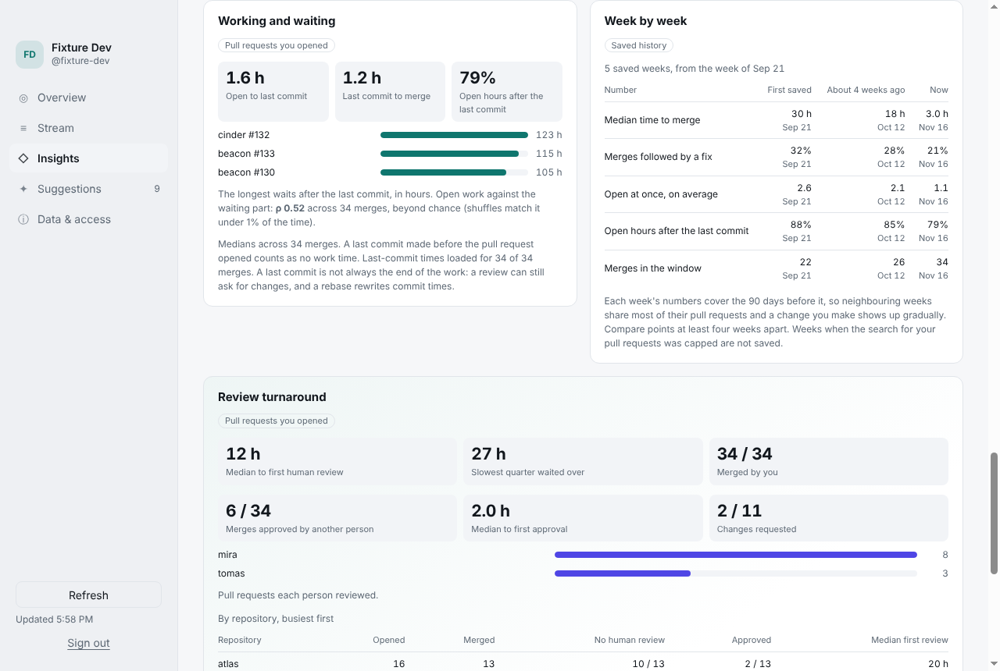

A finding appears in **What stands out** only when its sample is large enough, such as three merges in each group. These are descriptions of the loaded samples. A gap between two groups can come from something the app does not measure, and the size comparison says so when agent branches dominate one half.

### Reading All years

All years reads every calendar year GitHub lists for your account, up to the latest 20, in one request. Each year runs from January 1 to December 31, and the current year runs to today. The **Contribution year** tab uses GitHub's rolling 12 months instead, so its totals differ.

- **What stands out** reports your pace against the same date last year, your busiest full year, a change of 25% or more between the last two full years, your strongest month, a shift of 15 points or more in weekend work, and your longest streak. Year comparisons need full years with at least 50 contributions. The year the account was created and the current year are not full years.
- **Seasonality** averages each full year's share by month, so one busy year does not dominate. A month is reported as strongest when it averages at least 13% and is a top-three month in at least half of those years.
- **Records** shows the longest streak and the longest break between active days across every loaded year. Streaks continue across New Year.
- **Year by year** lists totals, active days, the longest streak, commits, pull requests, reviews, issues, and the weekend share for each year. Restricted contributions are counted in the totals without details.

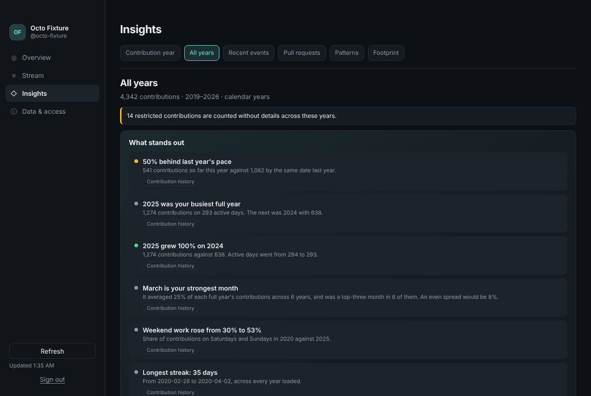

### Reading Footprint

Footprint reads the 10 repositories you own that were pushed most recently, leaving out forks and archived repositories.

- **Repositories** lists page views, unique visitors, and clones from GitHub's [traffic API](https://docs.github.com/en/rest/metrics/traffic) for the last 14 days. It also lists stars, forks, and stars gained in the last 30 days. Star gains come from star dates for repositories with up to 100 stars, or from saved daily counts, marked `*`.
- **Views by week** covers 13 weeks. GitHub keeps 14 days of traffic, so older weeks come from saved history once you turn it on. Grey weeks have no data. The four-week comparison appears once 56 days are saved.
- **Where visitors come from** sums each referring site across repositories for the last 14 days. GitHub lists up to 10 per repository. Sites first seen in the last 30 days are listed once saved history began at least 14 days before.
- **What stands out** reports when one repository draws most views, new stars per 100 unique visitors, repositories with many visitors and no new stars, clones far above visitors, a four-week change of 25% or more, and new referring sites. Unique visitors are counted per repository, so one person who visits two repositories counts twice. Clones can include automated ones such as CI checkouts.

Traffic needs a token with read access to **Administration** on your repositories, or a classic token with access to them. Without it, Activity Desk makes one traffic request, stops, and shows which permission GitHub asked for.

### Reading comment text

In **Your events**, rows for comments, review comments, commit comments, and reviews show the text you wrote. Issues and pull requests you opened show their description. The **Comments** and **Agents** filters list these rows together, and an agent's comment is marked with the agent's color.

- Short text appears in full. Longer text shows a two-line preview. Select **Show full comment** to read the rest in place, with its line breaks, and **Hide comment** to fold it again. Text you expanded stays open while you filter or search, and **Search** also matches comment text.
- The stream hides HTML comments. If deeply nested comment markup cannot be fully cleaned in a bounded number of passes, the row still shows the author and thread link, with the body withheld.
- Text comes from GitHub's event payload. When the payload leaves the text out, Activity Desk uses your matching comment from **Conversations**, from the same thread and within two minutes of the event, and marks it **text from Conversations**. When neither has it, the row says the text is unavailable.
- Hidden HTML comments that bots and agents leave in their text are removed, and text over 20,000 characters is cut short with a count of what was left out.

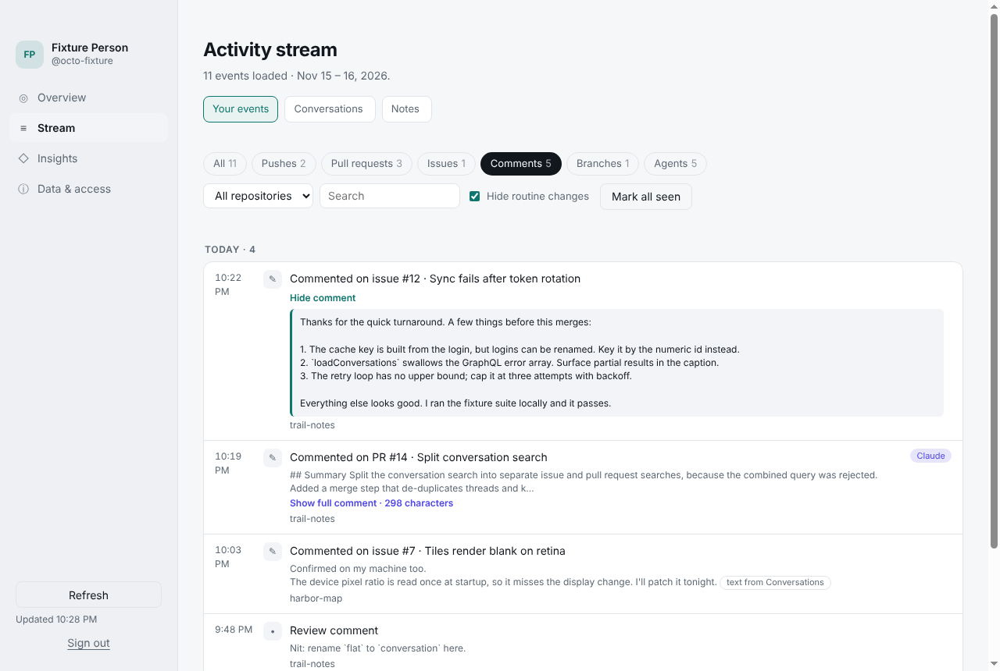

### Reading Conversations

Your events come from GitHub's Events feed, which lists only your own actions and can lag by minutes or hours. Conversations reads the threads directly, so each **Refresh** shows the latest comments as of that moment, including replies from other people.

- Threads come from two GitHub searches, one for issues and one for pull requests, that involve you, meaning you authored, were assigned, were mentioned, or commented. GitHub's issue search requires one of `is:issue` or `is:pr`, so the two kinds are searched separately in one request. The searches cover threads updated in the last 30 days, open or closed, with the 25 most recently updated issues and the 25 most recently updated pull requests loaded. Search can take a short time to notice a thread that just changed. Comments on threads it already lists are read live.
- Each thread shows its latest 10 comments and its latest 10 reviews, with up to 5 review comments per review. The caption says when a thread or the thread list was cut short.
- **Awaiting reply** keeps the latest comment on each open thread you opened or wrote in, when that comment is from someone else. Bot comments are skipped, so a bot posting after a person's reply does not hide it. These rows carry an **awaiting reply** tag in every filter, and the same threads appear in Overview under **Replies to answer**.
- **From others** hides your own comments. **Bots** shows comments from GitHub Apps and accounts whose names end in `[bot]`. The **New** tag and the Stream badge count only comments from other people.
- If a refresh cannot read conversations, Stream keeps the previous load and says so in the caption. If only one of the two searches returns, the caption names the kind that did not load.

### Using Notes

**Stream → Notes** keeps sticky notes next to your activity, with a list on the left and the selected note on the right.

- Select **New note**, or press ⌘N while Notes is showing, and start typing. The first line becomes the title in the list, and the next lines become its preview. Notes save as you type. The status under the note shows **Saved** once a change is stored.
- Pick a color for each note, **Pin** notes to keep them at the top, and use **Search notes** to filter by text. **Delete** asks before it removes a note. A note left empty is removed when you move to another note.
- A note holds up to 20,000 characters, and each account can keep up to 300 notes.

Notes are stored only on this Mac. See [Local data and privacy](#local-data-and-privacy).

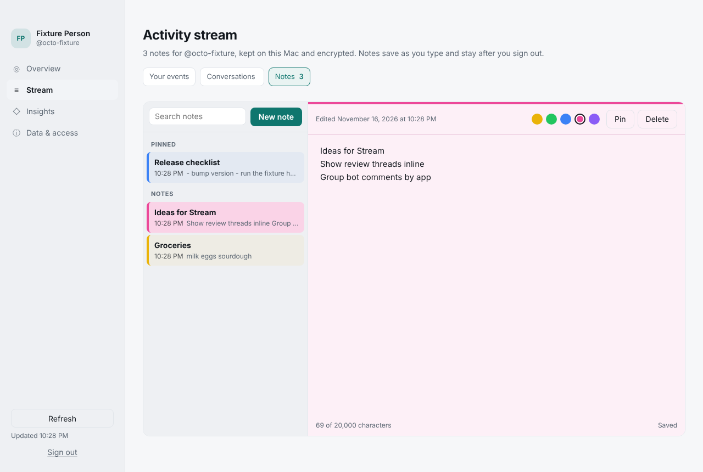

### Reading Suggestions

Suggestions turns patterns in the loaded data into specific changes to try. It adds no GitHub requests. It reads the same events, pull requests, contribution year, conversations, notifications, traffic, and token details as the other views. The sidebar count shows how many apply.

Each card has up to six parts:

- **Based on** names the sample the card rests on, such as 14 merged pull requests.
- **From Patterns** links to the finding in Insights → Patterns that the card acts on.
- **Seen** describes what the loaded data shows and names the source. Where a card's advice can be tested against your own merges, Seen includes that test: how often a fix followed the merges the advice targets, against the rest.
- **Why** gives the reason the change may help. Each claim carries a numbered link to its source. Cards that rest only on your data, such as **Answer replies waiting on your threads**, have no Why.
- **Try** is the change to make.
- **Where** lists up to three places to start, such as the repositories where unreviewed merges collect, the largest merges, the oldest open pull requests or branches, or the people whose pull requests you take longest to review. A named pull request, issue, or repository opens on github.com when you select it. The app builds that link itself from the repository name and number, and opens nothing but github.com pages this way.
- The links at the bottom of a card record what you decided about it. **Trying this** records the date and the number the advice should move, such as the share of merges followed by a fix. **Snooze 7 days** and **Snooze 30 days** hide the card until then. **Dismiss** moves it to **Set aside**. The token-access warning has none of these.

A card tagged **Beyond chance** rests on a gap or correlation that passed the page's shared chance bar, and comes before other cards of the same kind. Warnings are kept for outcomes in your own data and for token access. **Get a second look before merging** and **Review agent branches like a colleague's work** are notes unless your own merges back them: the merges they target were followed by fixes more often than the rest, beyond chance. When both apply they end in the same advice, so the second is shown inside the first, and **What was checked** says so.

Cards you are trying come first, and a **Trying** panel above them shows each one's number when you started and now. A card stays in the panel after it stops appearing, which is often the point: it says **No longer suggested** beside the change. Each number covers the loaded window, the last 90 days for pull requests, so a change shows up gradually as older work leaves it. **Set aside**, below the cards, lists snoozed and dismissed cards with **Show again**. A dismissed card comes back on its own, with a line saying why, when its number is clearly worse than when you dismissed it: at least a quarter higher, and past a floor for its kind (10 points for a share, 12 hours, 100 lines, or 2 pull requests or branches). These choices are kept per account in the app's data folder, encrypted like notes. They hold rule names, dates, and the one number each card was measured by, and are closed in the public view.

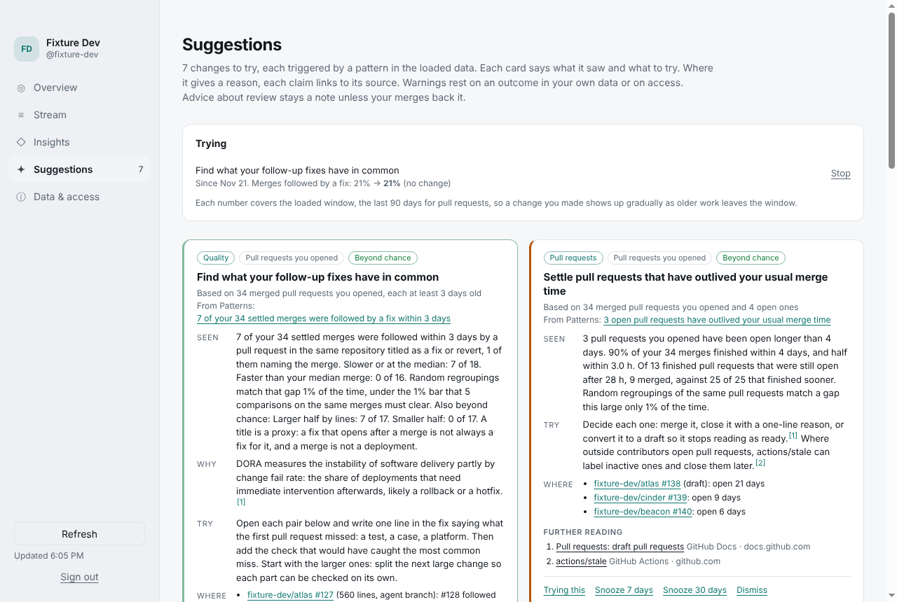

With saved history on, three cards read their weekly snapshots instead of the two numbers. These are **Find what your follow-up fixes have in common** (merges followed by a fix), **Finish open pull requests before opening the next** (median time to merge), and **Merge finished pull requests before they sit** (open hours after the last commit). The row starts at the last saved week on or before the day you started, and lists each week since: for example, "Week by week from Sep 21, the last saved week before you started: 30 h → 18 h → 9.0 h → 4.0 h". It needs two saved weeks. Until then, or with history off, the row compares the number saved when you started with now. A long series keeps its first week and the latest four. Snapshots describe the whole account, so a trial in a repository view always uses its starting number, and the panel says so. Other cards have no weekly snapshot and always compare their two numbers.

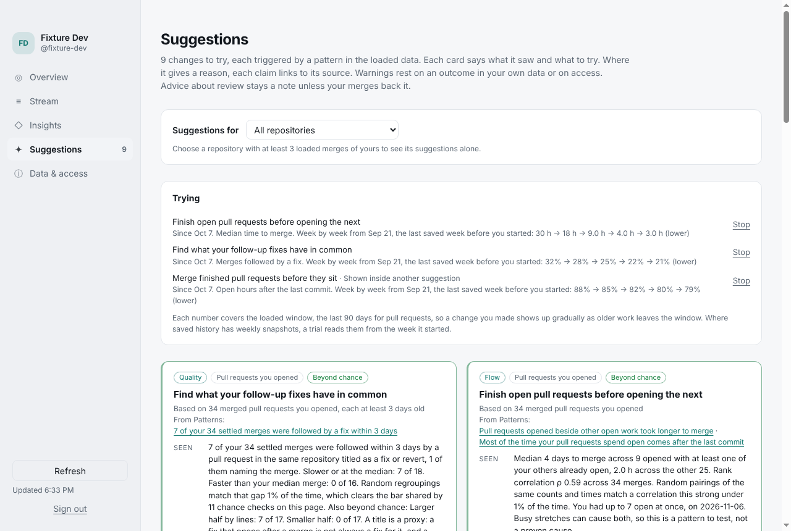

**Suggestions for** picks one repository. It lists the repositories where at least three pull requests you opened have merged among those loaded, busiest first. In a repository view, every pull request suggestion runs on that repository's pull requests alone: merge times, reviews, follow-up fixes, open work, and review partners. Your projects are often unlike each other, and rulesets, code owners, and branch settings are set per repository anyway. Samples are smaller, so more cards read **Not enough data**, and What was checked adds "Counted in owner/repo only" to each. A repository view runs its own chance checks under its own shared bar, and says how many ran and passed. The trajectory is left out, since it describes the whole account. Cards from the Events feed, the contribution calendar, notifications, conversations, traffic, or the token are tagged **Account-wide** and are the same in every view. Trying, snoozing, and dismissing in a repository view apply to that repository only, so dismissing a card for one repository keeps it in the others and in All repositories. On Account-wide cards, one choice applies everywhere. From Patterns links appear only in All repositories, because Patterns describes the whole account. The choice of repository is not saved between launches.

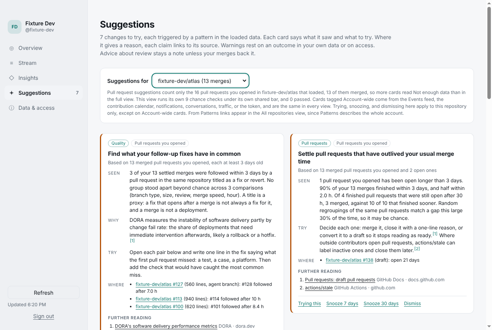

**Further reading** lists the sources in order. Selecting a source opens it in your browser. Activity Desk opens only links from its built-in list, and only on known hosts.

A suggestion appears only when its sample is large enough. **What was checked** lists every suggestion with one of seven results: suggested, shown inside another suggestion, snoozed, dismissed, nothing found, not enough data (with the minimum it needs), or source unavailable. A source is unavailable when its request failed, such as the Events feed or the search for pull requests you opened, or when the token cannot read it, such as traffic without Administration access. Suggestions describe patterns in the loaded samples, not their causes. A merge without a recorded review, for example, may still have been checked another way.

| Suggestion | Appears when | Sources |
| --- | --- | --- |
| Find what your follow-up fixes have in common | At least 2, and 20% or more, of 5 or more merges you opened were followed by a fix within three days. Each merge must be at least three days old. When a comparison stands apart beyond chance, the card names it and says where to start. | DORA on software delivery metrics |
| Finish open pull requests before opening the next | Across 8 or more merges you opened, the number of your other pull requests open when each one opened has a positive rank correlation of 0.3 or more with its time to merge, beyond chance. | DORA on work in process limits |
| Merge finished pull requests before they sit | Across 6 or more merges you opened with a last-commit time, half or more of the hours they spent open came after their last commit. When **Finish open pull requests before opening the next** also appears, this card is shown inside it. | DORA on work in process limits |
| Get a second look before merging | You have 3 or more merged pull requests, and half or more had no review from another person. If nobody else reviewed your work, it suggests required status checks instead of approvals. Only the first 10 reviews on each pull request are read, and the card says when that cut any short. | GitHub Docs on self-approval and rulesets; Bacchelli and Bird, ICSE 2013 |
| Review agent branches like a colleague's work | At least 3 agent-branch merges are loaded, and either half or more have no recorded review or, with at least 3 other merges loaded, their unreviewed share is 30 points above those. | Perry et al., ACM CCS 2023; GitHub Docs on Copilot cloud agent and rulesets |
| Ask for a reviewer when you open the pull request | Your pull requests waited a median of one day or more for a first review from another person, across 3 or more. | Google Engineering Practices; GitHub Docs on code owners; CHAOSS |
| Answer other people's pull requests within a day | Either your first review on pull requests by other people came a median of one day or more after you were asked, across 5 or more with a readable review time, or 2 or more open review requests to you by name have waited a day since the latest request. Your review time starts at the request to you, or when the pull request was ready for review if no request came first. **Where** lists the requests waiting longest first. | Google Engineering Practices |
| Spread reviews beyond one person | One person accounts for 60% or more of reviewer visits on your work, counting each reviewer once per pull request, across 4 or more pull requests reviewed by another person. | Mirsaeedi and Rigby, ICSE 2020; GitHub Docs on team review assignment |
| Split large pull requests | With 6 or more merges, either the larger half took at least twice as long to merge as the smaller half, or the median merge changed 400 lines or more. | Google Engineering Practices; Kudrjavets et al., MSR 2022 |
| Settle pull requests that have outlived your usual merge time | With 6 or more merges of your own: two or more of your open pull requests are older than 90% of those merges took and at least a day old, or one is and has been open a week. With fewer merges it falls back to the fixed line and the title **Settle pull requests that have been open for weeks**: two or more open more than 14 days, or one more than 30. | GitHub Docs on drafts; actions/stale |
| Agree on the approach before building | 30% or more of 4 or more finished pull requests you opened closed without merging. It counts the pull requests you opened in the last 90 days, by search, and falls back to those opened in the loaded events when the search did not load or found fewer than 4 finished ones. | GitHub Docs on drafts |
| Open a draft pull request early, or delete the branch | Half or more of 4 or more branches created in the loaded events, each at least 2 days old, have no pull request. | GitHub Docs on drafts and automatic branch deletion |
| Answer replies waiting on your threads | On 2 or more open issues or pull requests you opened, the latest comment from a person, not a bot, is from someone else and is 2 or more days old. | None. The suggestion rests on your data. |
| Give each repository its own block of time | Half or more of 4 or more work sessions with several events crossed repositories. | Meyer et al., FSE 2014; Mark et al., CHI 2008 |
| Leave yourself a next step before a break | An active day is followed by another active day at least 30 points more often than an idle day is. Needs at least 10 days after active days and 10 after idle days. | Parnin and Rugaber, Software Quality Journal 2011 |
| Review late-night changes the next day | At least 15% of 20 or more loaded events, and at least 5, happened between midnight and 4am local time. | Eyolfson et al., Empirical Software Engineering 2014 |
| Get Actions notifications only for failures | At least 40% of 10 or more unread notifications are routine CI updates. Needs a classic token with `notifications`. Only the first page of 50 is read, and the card says so when there are more. | GitHub Docs on Actions notifications |
| Use labels instead of title prefixes | 3 or more issues you opened in the loaded events start with a bracketed tag such as `[bug]`. | GitHub Docs on filtering and issue forms |
| Make the README's first screen do the work | A repository you own had 20 or more unique visitors in 14 days and no new stars, by star dates. | GitHub Docs on READMEs, topics, and social previews |
| Switch to a read-only fine-grained token | The signed-in classic token has a scope that allows writes. | GitHub Docs on personal access tokens |

Pull request suggestions use the pull requests you opened in the last 90 days plus those referenced in recent events. **Split large pull requests** and **Review agent branches like a colleague's work** use every loaded pull request, the same as **Merge patterns**. Agent branches are matched by prefix such as `claude/` or `codex/`. Late-night and session suggestions use events, not commits. Events can lag, and the feed holds at most 300.

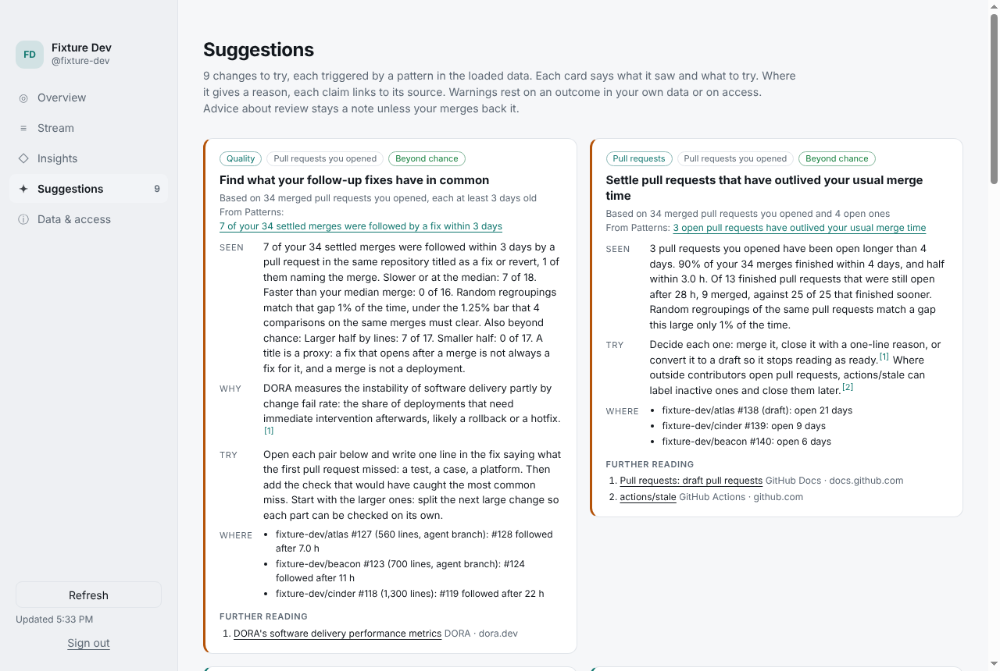

## What the numbers cover

| Source | Coverage |
| --- | --- |
| [Recent events](https://docs.github.com/en/rest/activity/events) | Up to 300 recent events from the past 30 days. GitHub can delay events, and token permissions affect what appears. |
| [Pull requests you opened](https://docs.github.com/en/search-github/searching-on-github/searching-issues-and-pull-requests#search-by-author) | Every pull request you opened in the last 90 days that the token can read, found by search, newest first and capped at 300. Each includes the author and time of its first 10 reviews, and its first 10 ready-for-review and review-request events. |
| [Public pull requests](https://docs.github.com/en/rest/search/search#search-issues-and-pull-requests) | Without a token: public pull requests the username opened in the last 90 days, newest first and capped at 300, from GitHub's issue search. Each has its state, creation, merge, and close times, title, and draft flag. Search returns no reviews, sizes, branch names, or commit times. |
| [Pull requests you reviewed](https://docs.github.com/en/search-github/searching-on-github/searching-issues-and-pull-requests#search-by-pull-request-review-status-and-reviewer) | Pull requests by other people that you reviewed, opened in the last 90 days, found by search, newest first and capped at 300. Each includes the time of your first review. Used only by **Review partners**, not by the pull request summaries about your own work. |
| Last-commit times | The time of the last commit on each of up to 120 of your newest merged pull requests, read as its own request so a token that cannot read commits loses only **Working and waiting**. |
| Other pull requests in events | Details for up to 40 more distinct PRs referenced in the loaded events, such as pull requests you reviewed. Pull requests the search already returned are not requested again. Review counts reflect records visible at refresh time. |
| [Contribution history](https://docs.github.com/en/graphql/reference/objects#contributionscollection) | Each calendar year GitHub lists for the account, up to the latest 20, with daily counts and contribution totals by type. |
| [Repository traffic](https://docs.github.com/en/rest/metrics/traffic) | Views, unique visitors, clones, and up to 10 referring sites for the last 14 days, for up to 10 repositories you own. Star dates for those with up to 100 stars. |
| Saved history | Off by default. When turned on, daily views and clones, star and fork counts, and referring-site sightings saved on this Mac from each refresh, for up to 400 days, and one snapshot a week of the numbers in **Week by week**. |
| [Rate-limit budget](https://docs.github.com/en/rest/rate-limit/rate-limit) | REST and GraphQL limits, and without a token the search limit, read after each refresh, with the requests that refresh sent. GitHub does not count this read against the limit. |
| [Contribution year](https://docs.github.com/en/graphql/reference/users#contributionscollection) | GitHub's rolling contribution calendar and up to 10 repository totals for commit contributions. The 30-day comparison includes today. |
| [Review requests](https://docs.github.com/en/search-github/searching-on-github/searching-issues-and-pull-requests#search-by-pull-request-review-status-and-reviewer) | Up to 50 open pull requests that ask you for a review, by name or through a team, oldest first, each with its latest 10 review-request events. |
| [Conversations](https://docs.github.com/en/search-github/searching-on-github/searching-issues-and-pull-requests#search-by-a-user-thats-involved-in-an-issue-or-pull-request) | Up to 25 issues and 25 pull requests that involve you and were updated in the last 30 days. Each shows its latest 10 comments, latest 10 reviews, and up to 5 review comments per review. |
| [Unread notifications](https://docs.github.com/en/rest/activity/notifications) | The first page of up to 50 unread notifications. GitHub serves them only to a classic token. |

Push counts describe the reported refs, including branches named `main` or `master`, other branches, and tags. A branch name alone cannot establish default-branch status or whether a push bypassed review. Agent signals are estimates based on known app slugs and branch prefixes.

## Using two tokens

You can save one fine-grained token and one classic token for the same GitHub account. Sign in with either, then paste the other into **Data & access → Token check → Add a second token for this account**. Pasting a token of a type that is already saved replaces it.

Before saving, Activity Desk asks GitHub who owns the new token and who owns the saved one. It saves the new token only when both belong to the same account, so one dashboard never mixes two accounts. A token GitHub rejects is not saved. If GitHub rejects the token that was already saved, for example because it expired, Activity Desk removes it and tells you.

| Source | Which token reads it |
| --- | --- |
| Unread notifications | The classic token. GitHub does not serve notifications to fine-grained tokens. |
| Recent events, pull requests you opened, pull requests you reviewed, review requests, conversations | Both. The results are joined, and **Data & access** says how many items only one token returned. A fine-grained token sees one account or organization, and a classic token sees what its scopes allow, so the joined list can include organization or private work the fine-grained token cannot reach. |
| Contribution year and contribution history | Both read the year. Activity Desk keeps the read that hides fewer contributions and uses the same token for the history. |
| Other pull requests in events, last-commit times | The fine-grained token first. Pull requests it cannot read are asked for again with the classic token. |
| Profile, repository list, repository traffic, star dates, rate limit | The fine-grained token first. When GitHub denies it, the classic token answers and goes first for that source until you sign out or change tokens. A rate-limited request is not repeated, because both tokens share the account's limit. |

Reading with both tokens roughly doubles the requests for the joined sources. **Rate-limit budget** shows what a refresh used.

With one token saved, the dashboard works as before: a fine-grained token reads everything except notifications, and a classic token reads what its scopes allow.

To remove one token, select **Remove this token** under it. The token stays valid on GitHub until you revoke it there. **Sign out** removes both.

## Viewing without a token

On the sign-in screen, enter a username under **GitHub username, without a token** and select **View public activity**. Activity Desk sends no credential in this view. It reads only what GitHub serves to anyone, and only for that username. The sidebar shows **public view** beside the name.

| View | Without a token |
| --- | --- |
| Overview | Time to merge from public pull requests, agent signals from public events, and the outcome warnings Patterns finds in public pull requests. **Waiting on you**, the contribution figures, the calendar, and unread notifications need a token. One item under **Needs a look** lists what is missing. |
| Stream → Your events | Up to 300 public events. Private events never appear. |
| Stream → Conversations, Notes | Need a token. Notes stay closed because a username alone does not show whose notes to open. |
| Insights → Recent events, and the event-based cards in Patterns | Work from the public events. |
| Insights → Pull requests | Public pull requests you opened in the last 90 days, found by GitHub's issue search: how many merged, the median time to merge, and how many are open. Reviews, sizes, and branch names need a token. |
| Insights → Patterns | The event-based cards, plus **After the merge**, **Open work**, and the merge-time comparisons from public pull requests. Comparisons that split on size, reviews, or agent branches are left out, never counted as zero. **Follow-through**, **Working and waiting**, **Review turnaround**, and **Review partners** need a token: search has no branch names, commit times, or reviews. |
| Insights → Contribution year, All years | Need a token. |
| Insights → Footprint | Public repositories with star and fork counts, and star dates for up to three of them. Views, clones, and referring sites are never public. |
| Suggestions | The checks that read events, and the pull request checks that need only dates, titles, and state: follow-up fixes, open work, pull requests past your usual merge time, and pull requests closed without merging. **What was checked** marks the rest as source unavailable, with "Needs a token" and what is missing. **Suggestions for** narrows them to one repository. Trying, snoozing, and dismissing need a token. |
| Data & access | What to change, what each source covers, what loaded, what the refresh sent and the remaining request budget, and the form to add a token. |

GitHub allows 60 requests an hour without a token, counted for your network address, so other people or tools on the same network share it. A refresh uses up to eight of them: the profile, up to three pages of events, the repository list, and up to three star-date reads. Public pull requests come from GitHub's issue search, which has its own limit without a token of 10 requests a minute. A refresh uses up to three, one per 100 pull requests, so refreshing about three times in a minute can reach it. When either limit is reached, Activity Desk says which and keeps the last loaded data. **Data & access → Rate-limit budget** shows what the last refresh sent and both limits.

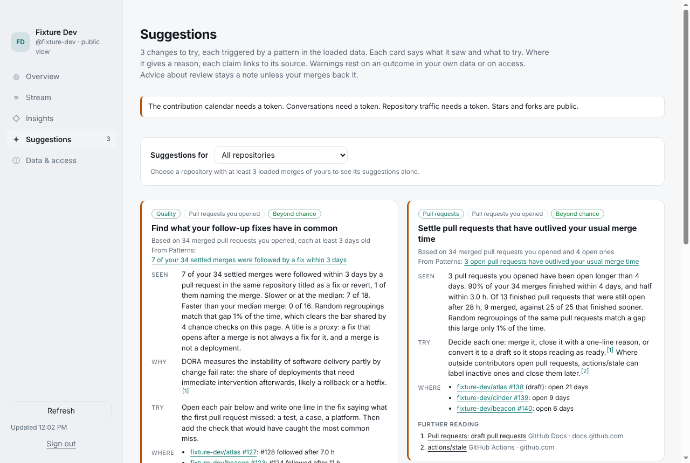

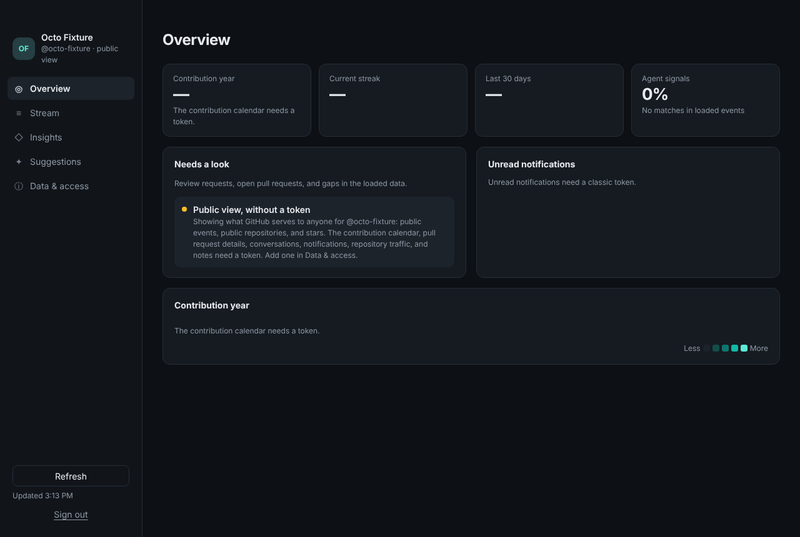

Only the username is saved, in a plain file in the app's data folder, so the view reopens next time. **Sign out** removes it. To load the rest, paste a token into **Data & access → Add a token to load everything else**. The public view ends and the dashboard reloads for the account the token belongs to.

## Reading Data & access

**What to change** comes first. It lists what would fill a gap in this refresh, marked **!**, and what would add data you may want, marked **+**. Each item says what is missing and why, and where the app can take the first step it has a button. The buttons open GitHub's token forms, focus the token field, or turn on saved history. Activity Desk never changes a token itself. The list covers:

- in the public view, what a token would add;
- tokens that expired, were rejected, expire soon, or have a scope that allows writes;
- each read GitHub denied, with the permission GitHub named for it in the `X-Accepted-GitHub-Permissions` header;
- repository traffic without Administration access;
- the unread inbox without a classic token;
- no private events with a fine-grained token;
- saved history turned off;
- missing last-commit times;
- a rate limit close to running out;
- sources that did not load this time.

When nothing applies, it says so.

**What each source covers** draws each source's time window on one axis covering the last year: the contribution year, pull requests you opened (or public pull requests), pull requests you reviewed, the loaded events, conversations, open review requests, repository traffic, and saved history. The dates are written beside each bar, so the chart is never the only place they appear. A lighter bar was cut short by a cap, such as GitHub's 300 events. Each source looks back a different distance, which is why a count from one does not match a count from another, or your profile page. All years reaches further back than the axis, and unread notifications have no window.

**Rate-limit budget** ends with **This refresh**: every request the refresh sent, by read, and the limit each drew on (REST, GraphQL, or, without a token, search). It counts a read retried with the other token twice, because GitHub received both. From the REST requests it estimates how many more refreshes fit before the limit resets. GraphQL limits are charged in points by query size, so the GraphQL bar moves by points, not by requests.

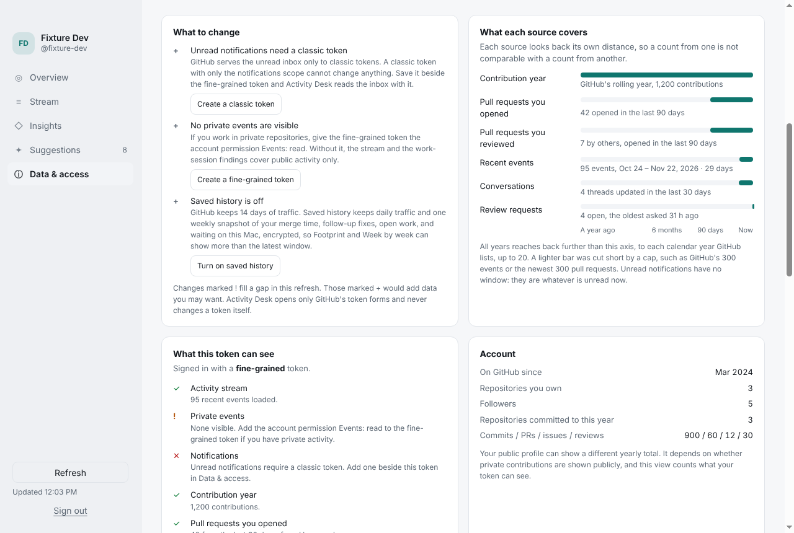

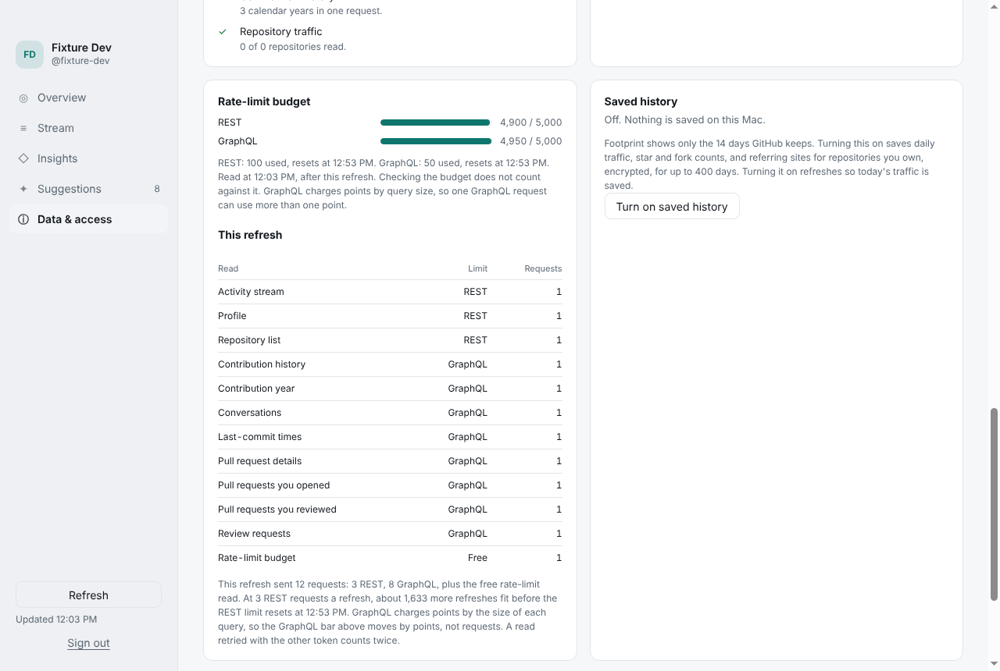

## Checking your tokens

**Data & access → Token check** reads what GitHub reports about each saved token on each response.

- **Expires** shows the expiry date when GitHub sends one. Overview warns 14 days before it and names the token.
- **Scopes** lists a classic token's scopes. Overview warns when a scope such as `repo` allows writes. Activity Desk only sends allowlisted reads, but a narrower token limits what a leaked copy could do: a read-only fine-grained token, or beside one, a classic token with only `notifications`.
- **Answered this refresh** lists the sources each token returned, so you can see which token a number came from.
- When a REST request is denied, the card names the permission GitHub lists for it in the `X-Accepted-GitHub-Permissions` header, under the token that was denied. GraphQL sources report missing access as partial results under **What this token can see** instead.
- Overview warns when GitHub rejects a saved token while the other one still works.

**Rate-limit budget** shows how much of the REST and GraphQL limits remain and when each resets. Overview warns when less than 10% of either remains. GraphQL charges points by query size, so one request can use more than one point.

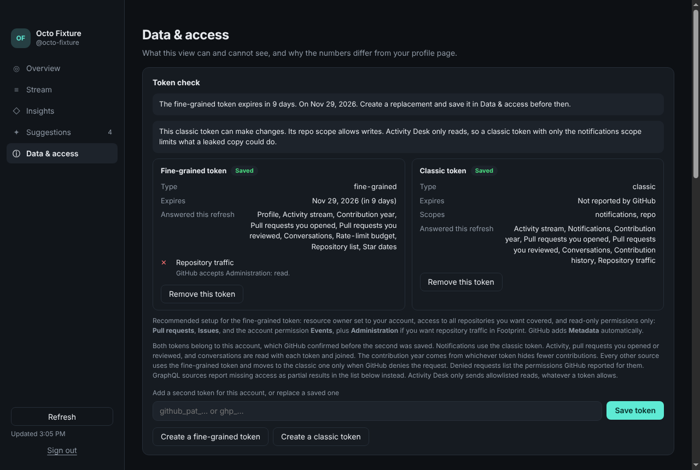

## Local data and privacy

The main process sends each token to `api.github.com` for allowlisted reads, and the window never receives a token back. macOS Keychain backs encryption of the saved tokens, which are kept together in one file in the local Electron profile. A token saved by an earlier version, encrypted or plaintext, moves into that file on first use.

In the public view no token exists. Requests go to `api.github.com` without a credential, and only the username is saved.

**Sign out** clears the dashboard and removes the saved tokens, or the saved username in the public view. The account's seen timestamp, saved history, notes, and suggestion card states remain in the local profile.

**Notes** are kept in the app's data folder (`~/Library/Application Support/Activity Desk`), not inside the app itself, so updating or replacing the app keeps them. Only the main process reads or writes them. They are encrypted with the same macOS Keychain-backed key as the token, and each account has its own notes. They are never sent to GitHub. If the notes file cannot be decrypted, for example after a Keychain change, Activity Desk keeps the unreadable file beside it as `notes-unreadable-….enc`, starts a new notebook, and says so in Notes and in **Data & access → Notes on this Mac**.

**Saved history** is off until you turn it on with **Save history on this Mac** in Footprint or **Turn on saved history** in **Data & access**. It is the only GitHub data Activity Desk keeps, and turning it on refreshes so today's traffic is saved straight away. The main process writes it from traffic and repository-list responses for repositories the signed-in account owns, plus one weekly snapshot of five outcome numbers that the window computes from your pull requests. It accepts only those five numbers, each within a fixed range, and works out the week itself. Each account is stored separately. It is encrypted with the same macOS Keychain-backed key as the token and kept for 400 days, up to 50 repositories per account. **Data & access → Saved history** shows what is stored, deletes it for the current account, or turns it off. Turning it off deletes it for every account on this Mac and stops saving until you turn it on again. If the file cannot be decrypted, for example after a Keychain change, Activity Desk starts a new history and says so. The dashboard can display private repository names and activity. Use a separate profile and synthetic data for screenshots you plan to share.
