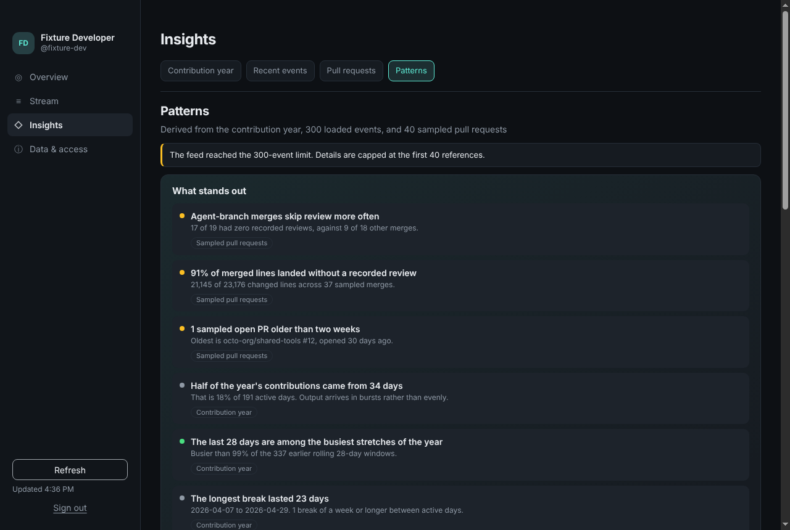
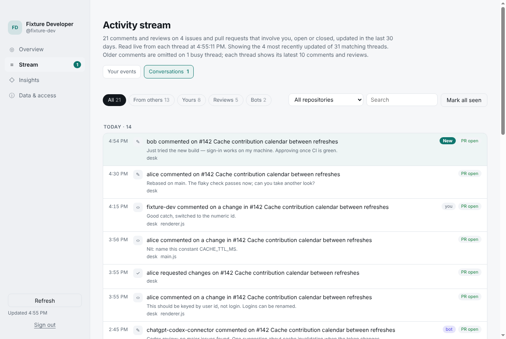

# User guide

Activity Desk gives you one place to review GitHub activity across the repositories visible to your token. See [Quick start](quick-start.md) to install the app and sign in.

## Views

- **Overview** highlights recent contribution trends, new comments from others, open pull requests in the loaded sample, and unread notifications when available.
- **Stream** has two sources. **Your events** filters your loaded events by type, repository, and search text. Clear **Hide routine changes** to include events such as PR label changes. **Conversations** lists comments, reviews, and review comments on issues and pull requests that involve you, open or closed, including replies from other people. **Mark all seen** updates a timestamp for your account on this Mac, and both sources mark newer items as **New**.
- **Insights** shows your contribution calendar, an event heatmap, and merge timing, recorded reviews, and change sizes for sampled pull requests. In **Recent events**, select a repository to open its events in Stream. **Patterns** derives findings the other views do not state: how concentrated your output is, where the last four weeks rank in the year, how events group into work sessions, how agent-branch merges compare with the rest, whether weekly output shifted, how often branches reach a merge, and how long your pull requests wait for a person to review them.
- **Data & access** shows which sources loaded and flags limits, missing data, and permission errors.

### Reading Patterns

Patterns makes no extra requests. It recombines the three loaded sources, and each card and finding names the source it came from. The pull request lookup also returns the author and time of the first 10 reviews on each sampled pull request.

- **Output rhythm** uses the contribution year. It shows how few days hold half of your contributions, the typical run of consecutive active days, the longest break, and the rank of the last 28 days among earlier rolling 28-day windows.
- **Work sessions** and **Work mix** use recent events. A session is a run of events with gaps under an hour, in local time. A session crosses repositories when its events touch more than one.
- **Merge patterns** uses the sampled pull requests. It compares agent-branch merges with other merges, and the larger half with the smaller half once six merges are loaded.
- **Trajectory** uses the contribution year. It finds the week that best splits weekly totals into a before and an after level, with at least six weeks on each side. The split counts as a shift only when it beats 95% of the same weeks shuffled into random order and moves the weekly average by at least a quarter, because the best of many possible splits can look meaningful in pure noise. It also compares the chance of an active day after an active day with the chance after an idle day.
- **Follow-through** uses recent events with the sampled pull requests. It counts branches created in the feed that are at least two days old and have no pull request from that branch, and the current outcome of pull requests you opened in the feed.
- **Review turnaround** uses the sampled pull requests you authored. Following the [CHAOSS time to first response](https://chaoss.community/kb/metric-time-to-first-response/) definition, it measures the time from creation to the first review by a person other than you. Bot reviews are left out. It also counts merges that only bots reviewed, merges you made yourself, and the people who review your work. Time spent as a draft counts toward the wait, because the lookup does not read when a draft became ready.

A finding appears in **What stands out** only when its sample is large enough, such as three merges in each group. These are descriptions of the loaded samples. A gap between two groups can come from something the app does not measure, and the size comparison says so when agent branches dominate one half.

### Reading Conversations

Your events come from GitHub's Events feed, which lists only your own actions and can lag by minutes or hours. Conversations reads the threads directly, so each **Refresh** shows the latest comments as of that moment, including replies from other people.

- Threads come from a GitHub search for issues and pull requests that involve you, meaning you authored, were assigned, were mentioned, or commented. The search covers threads updated in the last 30 days, open or closed, with the 25 most recently updated loaded. Search can take a short time to notice a thread that just changed. Comments on threads it already lists are read live.
- Each thread shows its latest 10 comments and its latest 10 reviews, with up to 5 review comments per review. The caption says when a thread or the thread list was cut short.
- **From others** hides your own comments. **Bots** shows comments from GitHub Apps and accounts whose names end in `[bot]`. The **New** tag and the Stream badge count only comments from other people.
- If a refresh cannot read conversations, Stream keeps the previous load and says so in the caption.

## What the numbers cover

| Source | Coverage |
| --- | --- |
| [Recent events](https://docs.github.com/en/rest/activity/events) | Up to 300 recent events from the past 30 days. GitHub can delay events, and token permissions affect what appears. |
| Pull requests | Details for up to 40 distinct PRs referenced in the loaded events, with the author and time of the first 10 reviews on each. Review counts reflect records visible at refresh time. |
| [Contribution year](https://docs.github.com/en/graphql/reference/users#contributionscollection) | GitHub's rolling contribution calendar and up to 10 repository totals for commit contributions. The 30-day comparison includes today. |
| [Conversations](https://docs.github.com/en/search-github/searching-on-github/searching-issues-and-pull-requests#search-by-a-user-thats-involved-in-an-issue-or-pull-request) | Up to 25 issues and pull requests that involve you and were updated in the last 30 days. Each shows its latest 10 comments, latest 10 reviews, and up to 5 review comments per review. |
| [Unread notifications](https://docs.github.com/en/rest/activity/notifications) | The first page of up to 50 unread notifications with a supported token. |

Push counts describe the reported refs, including branches named `main` or `master`, other branches, and tags. A branch name alone cannot establish default-branch status or whether a push bypassed review. Agent signals are estimates based on known app slugs and branch prefixes.

## Local data and privacy

The main process sends the token to `api.github.com` for allowlisted reads. macOS Keychain backs encryption of the token in the local Electron profile. Activity Desk encrypts a legacy plaintext token on first use.

**Sign out** clears the dashboard and removes the saved token. The account's seen timestamp remains in the local profile. The dashboard can display private repository names and activity. Use a separate profile and synthetic data for screenshots you plan to share.
