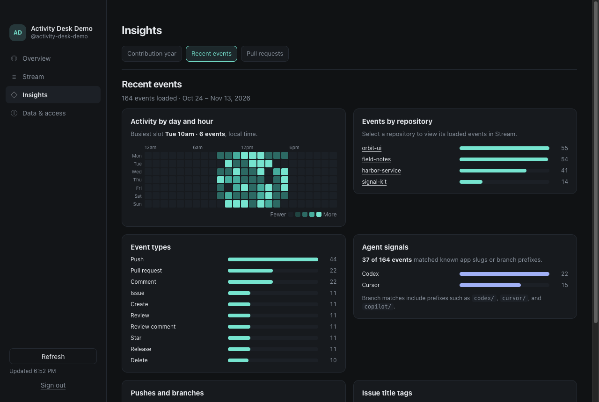
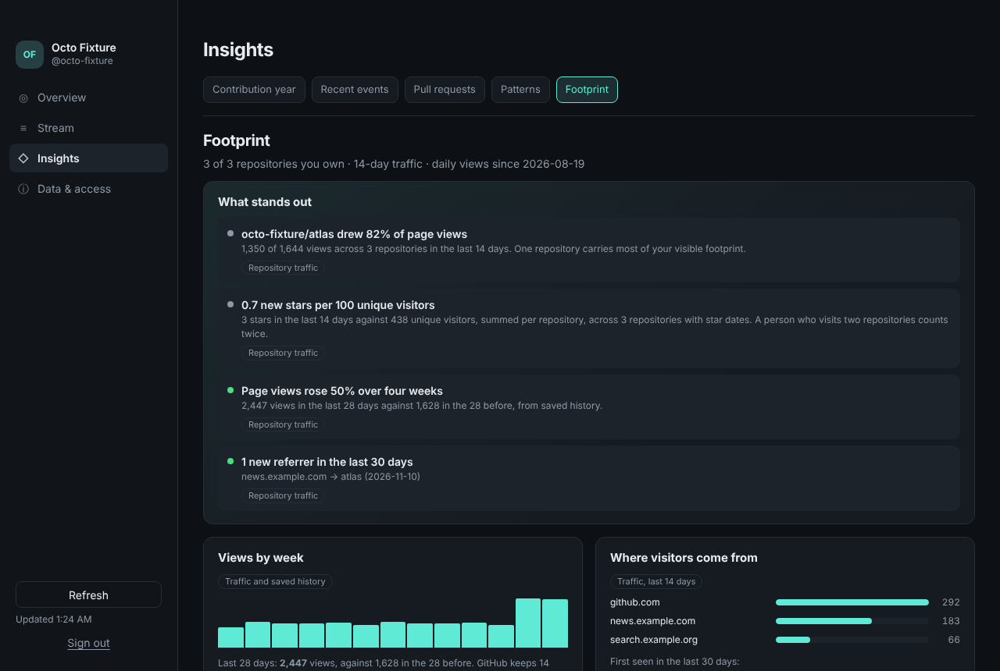

# User guide

Activity Desk gives you one place to review GitHub activity across the repositories visible to your token. See [Quick start](quick-start.md) to install the app and sign in.

## Views

- **Overview** highlights recent contribution trends, new comments from others, open pull requests in the loaded sample, and unread notifications when available.
- **Stream** has two sources. **Your events** filters your loaded events by type, repository, and search text. Clear **Hide routine changes** to include events such as PR label changes. **Conversations** lists comments, reviews, and review comments on issues and pull requests that involve you, open or closed, including replies from other people. **Mark all seen** updates a timestamp for your account on this Mac, and both sources mark newer items as **New**.
- **Insights** shows your contribution calendar, an event heatmap, and merge timing, recorded reviews, and change sizes for loaded pull requests. In **Recent events**, select a repository to open its events in Stream. **Patterns** derives findings the other views do not state: how concentrated your output is, where the last four weeks rank in the year, how events group into work sessions, how agent-branch merges compare with the rest, whether weekly output shifted, how often branches reach a merge, how long your pull requests wait for a person to review them, and who you review with in each direction. **Footprint** shows traffic to the repositories you own. See [Reading Footprint](#reading-footprint). **All years** compares calendar years. See [Reading All years](#reading-all-years).
- **Suggestions** turns patterns in the loaded data into specific changes to try, each with its evidence and sources. See [Reading Suggestions](#reading-suggestions).
- **Data & access** shows which sources loaded and flags limits, missing data, and permission errors. **Token check** and **Rate-limit budget** describe the token itself. See [Checking your token](#checking-your-token).

### Reading Patterns

Patterns recombines the loaded sources, and each card and finding names the source it came from. Only **Review partners** adds a request of its own: a search for pull requests by other people that you reviewed. The pull request details include the author and time of the first 10 reviews on each pull request.

- **Output rhythm** uses the contribution year. It shows how few days hold half of your contributions, the typical run of consecutive active days, the longest break, and the rank of the last 28 days among earlier rolling 28-day windows.
- **Work sessions** and **Work mix** use recent events. A session is a run of events with gaps under an hour, in local time. A session crosses repositories when its events touch more than one.
- **Merge patterns** uses the loaded pull requests. It compares agent-branch merges with other merges, and the larger half with the smaller half once six merges are loaded.
- **Trajectory** uses the contribution year. It finds the week that best splits weekly totals into a before and an after level, with at least six weeks on each side. The split counts as a shift only when it beats 95% of the same weeks shuffled into random order and moves the weekly average by at least a quarter, because the best of many possible splits can look meaningful in pure noise. It also compares the chance of an active day after an active day with the chance after an idle day.
- **Follow-through** uses recent events with the loaded pull requests. It counts branches created in the feed that are at least two days old and have no pull request from that branch, and the current outcome of pull requests you opened in the feed.
- **Review turnaround** uses the pull requests you opened in the last 90 days, found by search, plus any older ones you authored that appear in recent events. The note under the card says when the search was capped. Following the [CHAOSS time to first response](https://chaoss.community/kb/metric-time-to-first-response/) definition, it measures the time from creation to the first review by a person other than you. Bot reviews are left out. It also counts merges that only bots reviewed, merges you made yourself, and the people who review your work. Time spent as a draft counts toward the wait, because the lookup does not read when a draft became ready.
- **Review partners** shows who reviews your pull requests and whose pull requests you review, over the same 90 days. It combines the pull requests you opened with a second search, for pull requests by other people that you reviewed. Each row shows one person: whether review goes both ways, how many of your pull requests they reviewed, how many of theirs you reviewed, and the median time to a first review in each direction. Both directions are timed the same way as review turnaround, from creation to that person's first review. The app does not read when a review was requested, so waiting for a request counts toward the time. Bots and your own reviews are left out. Two findings can appear. One appears when you give at least three times as many reviews as you receive, or the reverse, with at least eight on the busier side. It needs both searches to load in full, because a missing or capped side would look like an imbalance. The other appears when you and one person each reviewed at least three of the other's pull requests, and the median first-review times in the two directions differ by a day or more. On an account where nobody else reviews, the card says so and shows nothing more.

A finding appears in **What stands out** only when its sample is large enough, such as three merges in each group. These are descriptions of the loaded samples. A gap between two groups can come from something the app does not measure, and the size comparison says so when agent branches dominate one half.

### Reading All years

All years reads every calendar year GitHub lists for your account, up to the latest 20, in one request. Each year runs from January 1 to December 31, and the current year runs to today. The **Contribution year** tab uses GitHub's rolling 12 months instead, so its totals differ.

- **What stands out** reports your pace against the same date last year, your busiest full year, a change of 25% or more between the last two full years, your strongest month, a shift of 15 points or more in weekend work, and your longest streak. Year comparisons need full years with at least 50 contributions. The year the account was created and the current year are not full years.
- **Seasonality** averages each full year's share by month, so one busy year does not dominate. A month is reported as strongest when it averages at least 13% and is a top-three month in at least half of those years.
- **Records** shows the longest streak and the longest break between active days across every loaded year. Streaks continue across New Year.
- **Year by year** lists totals, active days, the longest streak, commits, pull requests, reviews, issues, and the weekend share for each year. Restricted contributions are counted in the totals without details.

### Reading Footprint

Footprint reads the 10 repositories you own that were pushed most recently, leaving out forks and archived repositories.

- **Repositories** lists page views, unique visitors, and clones from GitHub's [traffic API](https://docs.github.com/en/rest/metrics/traffic) for the last 14 days. It also lists stars, forks, and stars gained in the last 30 days. Star gains come from star dates for repositories with up to 100 stars, or from saved daily counts, marked `*`.
- **Views by week** covers 13 weeks. GitHub keeps 14 days of traffic, so older weeks come from saved history once you turn it on. Grey weeks have no data. The four-week comparison appears once 56 days are saved.
- **Where visitors come from** sums each referring site across repositories for the last 14 days. GitHub lists up to 10 per repository. Sites first seen in the last 30 days are listed once saved history began at least 14 days before.
- **What stands out** reports when one repository draws most views, new stars per 100 unique visitors, repositories with many visitors and no new stars, clones far above visitors, a four-week change of 25% or more, and new referring sites. Unique visitors are counted per repository, so one person who visits two repositories counts twice. Clones can include automated ones such as CI checkouts.

Traffic needs a token with read access to **Administration** on your repositories, or a classic token with access to them. Without it, Activity Desk makes one traffic request, stops, and shows which permission GitHub asked for.

### Reading Conversations

Your events come from GitHub's Events feed, which lists only your own actions and can lag by minutes or hours. Conversations reads the threads directly, so each **Refresh** shows the latest comments as of that moment, including replies from other people.

- Threads come from a GitHub search for issues and pull requests that involve you, meaning you authored, were assigned, were mentioned, or commented. The search covers threads updated in the last 30 days, open or closed, with the 25 most recently updated loaded. Search can take a short time to notice a thread that just changed. Comments on threads it already lists are read live.
- Each thread shows its latest 10 comments and its latest 10 reviews, with up to 5 review comments per review. The caption says when a thread or the thread list was cut short.
- **From others** hides your own comments. **Bots** shows comments from GitHub Apps and accounts whose names end in `[bot]`. The **New** tag and the Stream badge count only comments from other people.
- If a refresh cannot read conversations, Stream keeps the previous load and says so in the caption.

### Reading Suggestions

Suggestions turns patterns in the loaded data into specific changes to try. It adds no GitHub requests. It reads the same events, pull requests, contribution year, conversations, notifications, traffic, and token details as the other views. The sidebar count shows how many apply.

Each card has three parts:

- **Seen** describes what the loaded data shows and names the source.
- **Why** gives the reason the change may help. Each claim carries a numbered link to its source.
- **Try** is the change to make.

**Further reading** lists the sources in order. Selecting a source opens it in your browser. Activity Desk opens only links from its built-in list, and only on known hosts.

A suggestion appears only when its sample is large enough. **What was checked** lists every suggestion with one of four results: suggested, nothing found, not enough data (with the minimum it needs), or source unavailable. Suggestions describe patterns in the loaded samples, not their causes. A merge without a recorded review, for example, may still have been checked another way.

| Suggestion | Appears when | Sources |
| --- | --- | --- |
| Get a second look before merging | You have 3 or more merged pull requests, and half or more had no review from another person. If nobody else reviewed your work, it suggests required status checks instead of approvals. | GitHub Docs on self-approval and rulesets; Bacchelli and Bird, ICSE 2013 |
| Review agent branches like a colleague's work | At least 3 agent-branch merges are loaded, and either half or more have no recorded review or their unreviewed share is 30 points above other merges. | Perry et al., ACM CCS 2023; GitHub Docs on Copilot cloud agent and rulesets |
| Ask for a reviewer when you open the pull request | Your pull requests waited a median of one day or more for a first review from another person, across 3 or more. | Google Engineering Practices; GitHub Docs on code owners; CHAOSS |
| Spread reviews beyond one person | One person made 60% or more of the reviews on your work, across 4 or more reviewed pull requests. | Mirsaeedi and Rigby, ICSE 2020; GitHub Docs on team review assignment |
| Split large pull requests | With 6 or more merges, either the larger half took at least twice as long to merge as the smaller half, or the median merge changed 400 lines or more. | Google Engineering Practices; Kudrjavets et al., MSR 2022 |
| Settle pull requests that have been open for weeks | Two or more of your pull requests have been open more than 14 days, or one has been open more than 30. | GitHub Docs on drafts; actions/stale |
| Agree on the approach before building | 30% or more of 4 or more finished pull requests you opened in the loaded events closed without merging. | GitHub Docs on drafts |
| Open a draft pull request early, or delete the branch | Half or more of 4 or more branches created in the loaded events, each at least 2 days old, have no pull request. | GitHub Docs on drafts and automatic branch deletion |
| Answer replies waiting on your threads | On 2 or more open issues or pull requests you opened, the latest loaded comment is from another person and is 2 or more days old. Bots are left out. | None. The suggestion rests on your data. |
| Give each repository its own block of time | Half or more of 4 or more work sessions with several events crossed repositories. | Meyer et al., FSE 2014; Mark et al., CHI 2008 |
| Leave yourself a next step before a break | An active day is followed by another active day at least 30 points more often than an idle day is. | Parnin and Rugaber, Software Quality Journal 2011 |
| Review late-night changes the next day | At least 15% of 20 or more loaded events, and at least 5, happened between midnight and 4am local time. | Eyolfson et al., Empirical Software Engineering 2014 |
| Get Actions notifications only for failures | At least 40% of 10 or more unread notifications are routine CI updates. Needs a classic token with `notifications`. | GitHub Docs on Actions notifications |
| Use labels instead of title prefixes | 3 or more issues you opened in the loaded events start with a bracketed tag such as `[bug]`. | GitHub Docs on filtering and issue forms |
| Make the README's first screen do the work | A repository you own had 20 or more unique visitors in 14 days and no new stars, by star dates. | GitHub Docs on READMEs, topics, and social previews |
| Switch to a read-only fine-grained token | The signed-in classic token has a scope that allows writes. | GitHub Docs on personal access tokens |

Pull request suggestions use the pull requests you opened in the last 90 days plus those referenced in recent events. **Split large pull requests** and **Review agent branches like a colleague's work** use every loaded pull request, the same as **Merge patterns**. Agent branches are matched by prefix such as `claude/` or `codex/`. Late-night and session suggestions use events, not commits. Events can lag, and the feed holds at most 300.

## What the numbers cover

| Source | Coverage |
| --- | --- |
| [Recent events](https://docs.github.com/en/rest/activity/events) | Up to 300 recent events from the past 30 days. GitHub can delay events, and token permissions affect what appears. |
| [Pull requests you opened](https://docs.github.com/en/search-github/searching-on-github/searching-issues-and-pull-requests#search-by-author) | Every pull request you opened in the last 90 days that the token can read, found by search, newest first and capped at 300. Each includes the author and time of its first 10 reviews. |
| [Pull requests you reviewed](https://docs.github.com/en/search-github/searching-on-github/searching-issues-and-pull-requests#search-by-pull-request-review-status-and-reviewer) | Pull requests by other people that you reviewed, opened in the last 90 days, found by search, newest first and capped at 300. Each includes the time of your first review. Used only by **Review partners**, not by the pull request summaries about your own work. |
| Other pull requests in events | Details for up to 40 more distinct PRs referenced in the loaded events, such as pull requests you reviewed. Pull requests the search already returned are not requested again. Review counts reflect records visible at refresh time. |
| [Contribution history](https://docs.github.com/en/graphql/reference/objects#contributionscollection) | Each calendar year GitHub lists for the account, up to the latest 20, with daily counts and contribution totals by type. |
| [Repository traffic](https://docs.github.com/en/rest/metrics/traffic) | Views, unique visitors, clones, and up to 10 referring sites for the last 14 days, for up to 10 repositories you own. Star dates for those with up to 100 stars. |
| Saved history | Off by default. When turned on, daily views and clones, star and fork counts, and referring-site sightings saved on this Mac from each refresh, for up to 400 days. |
| [Rate-limit budget](https://docs.github.com/en/rest/rate-limit/rate-limit) | REST and GraphQL limits read after each refresh. GitHub does not count this read against the limit. |
| [Contribution year](https://docs.github.com/en/graphql/reference/users#contributionscollection) | GitHub's rolling contribution calendar and up to 10 repository totals for commit contributions. The 30-day comparison includes today. |
| [Conversations](https://docs.github.com/en/search-github/searching-on-github/searching-issues-and-pull-requests#search-by-a-user-thats-involved-in-an-issue-or-pull-request) | Up to 25 issues and pull requests that involve you and were updated in the last 30 days. Each shows its latest 10 comments, latest 10 reviews, and up to 5 review comments per review. |
| [Unread notifications](https://docs.github.com/en/rest/activity/notifications) | The first page of up to 50 unread notifications with a supported token. |

Push counts describe the reported refs, including branches named `main` or `master`, other branches, and tags. A branch name alone cannot establish default-branch status or whether a push bypassed review. Agent signals are estimates based on known app slugs and branch prefixes.

## Checking your token

**Data & access → Token check** reads what GitHub reports about the token on each response.

- **Expires** shows the expiry date when GitHub sends one. Overview warns 14 days before it.
- **Classic scopes** lists a classic token's scopes. Overview warns when a scope such as `repo` allows writes. Activity Desk only sends allowlisted reads, but a read-only fine-grained token limits what a leaked copy could do.
- When a REST request is denied, the card names the permission GitHub lists for it in the `X-Accepted-GitHub-Permissions` header. GraphQL sources report missing access as partial results under **What this token can see** instead.

**Rate-limit budget** shows how much of the REST and GraphQL limits remain and when each resets. Overview warns when less than 10% of either remains. GraphQL charges points by query size, so one request can use more than one point.

## Local data and privacy

The main process sends the token to `api.github.com` for allowlisted reads. macOS Keychain backs encryption of the token in the local Electron profile. Activity Desk encrypts a legacy plaintext token on first use.

**Sign out** clears the dashboard and removes the saved token. The account's seen timestamp and saved history remain in the local profile.

**Saved history** is off until you turn it on with **Save history on this Mac** in Footprint or **Turn on saved history** in **Data & access**. It is the only GitHub data Activity Desk keeps, and turning it on refreshes so today's traffic is saved straight away. The main process writes it from traffic and repository-list responses for repositories the signed-in account owns. Each account is stored separately. It is encrypted with the same macOS Keychain-backed key as the token and kept for 400 days, up to 50 repositories per account. **Data & access → Saved history** shows what is stored, deletes it for the current account, or turns it off. Turning it off deletes it for every account on this Mac and stops saving until you turn it on again. If the file cannot be decrypted, for example after a Keychain change, Activity Desk starts a new history and says so. The dashboard can display private repository names and activity. Use a separate profile and synthetic data for screenshots you plan to share.
